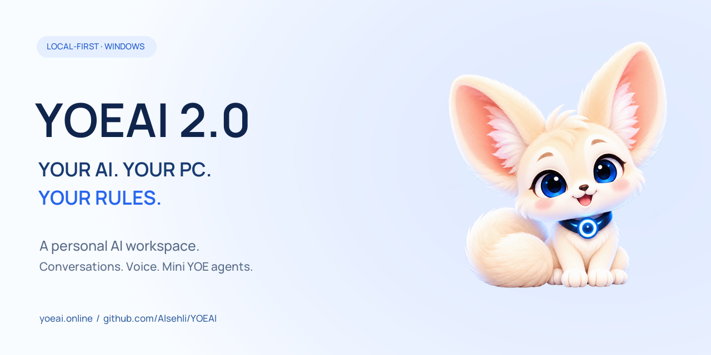

> **13 November 2026: one product, YOEAI.** Current app and installer work uses the YOEAI name. Lite/Normal names below identify historical releases only.

> **11 November — YOEAI 3.0 development source:** [Current changes and verification](docs/RELEASE-20261111-YOEAI-3.md) and [Lite-based source](editions/lite/README.md) include automatic research, linked models, faster model switching, context presets and composer updates. **No YOEAI 3.0 installer is published.** The download links below remain historical 2.0 previews.

> **8 November Lite update:** [Image Turbo preview](docs/RELEASE-20261108-LITE-IMAGE.md) adds local image generation to Lite. [Downloads](https://github.com/Alsehli/YOEAI/releases/tag/v2.0.20261108-lite-image-preview). Tested on an 8GB card; 24GB and fresh-PC image qualification remain pending.

> **7 November update:** [Native GGUF & Settings preview](docs/RELEASE-20261107.md). Updated source uses embedded native llama.cpp through a private worker; no external model server is required. The older release notes below describe historical builds. New unsigned preview downloads are available from the [release page](https://github.com/Alsehli/YOEAI/releases/tag/v2.0.20261107-native-preview).

<p align="center"></p>

# YOEAI

**Your AI. Your PC. Your Rules.** A local-first AI assistant for Windows.

[](docs/SETUP.md) [](requirements-build.txt) [](LICENSE) [](https://github.com/Alsehli/YOEAI/actions/workflows/windows-preview.yml) [](docs/RELEASE-CHECKLIST.md)

[Website](https://yoeai.online) · [Setup](docs/SETUP.md) · [Release readiness](docs/RELEASE-CHECKLIST.md) · [Report a bug](https://github.com/Alsehli/YOEAI/issues/new/choose) · [Contribute](CONTRIBUTING.md) · [Wiki](https://github.com/Alsehli/YOEAI/wiki) · [Roadmap](docs/ROADMAP.md) · [Repository guide](docs/REPOSITORY-GUIDE.md)

YOEAI combines local language models, practical Windows tools and specialized Mini YOE agents in one desktop workspace. It is a personal, non-profit project created and maintained by **[Mohamed Yusuf Alsehli](https://github.com/Alsehli)**. The cream-white YOE fox is its own visual identity.

## Current YOEAI build

The current product is **YOEAI**, with one app and installer. The active pipeline produces `YOEAI-Setup.exe` and `YOEAI-Payload.zip`; see [candidate builds](docs/INSTALLER-CANDIDATES.md). A qualified production download is not published yet. The internal `editions/lite/source` path is retained for compatibility, not as a separate edition.

## Historical Windows previews

[Lite Image Turbo: installer, matching source and checksums](https://github.com/Alsehli/YOEAI/releases/tag/v2.0.20261108-lite-image-preview) · [Normal native preview](https://github.com/Alsehli/YOEAI/releases/tag/v2.0.20261107-native-preview)

- Lite Image Turbo 8GB: download both Lite `.part1`–`.part2` files and `Join-Lite.ps1` into one folder. Run the joiner to reconstruct and verify the unchanged setup EXE, then run setup manually.
- Normal 16GB: run the Normal setup EXE.
- Verify SHA256SUMS.txt before installing. Back up your profile and preserve model files.

See the [Lite-specific source and build notes](editions/lite/README.md).

These are **unsigned previews**, not a newly clean-PC-qualified stable release. Models are not bundled. Read the [Lite verification and limitations](docs/RELEASE-20261108-LITE-IMAGE.md), [Normal native-preview notes](docs/RELEASE-20261107.md) and [installation guide](docs/WINDOWS-DOWNLOADS.md). Older installer qualifications apply only to their original builds.


## What is included?

| Workspace | Implemented capability | Requirements and limits |
|---|---|---|
| Conversation | Compatible GGUF model selection, history, local memory, Markdown and document/image interactions | Native runtime and compatible model; automatic vision routing needs its matching model/projector pair |
| Voice | Local dictation and read-aloud integrations | Corresponding speech workers/models; physical devices and language coverage require qualification |
| Windows YOE | File browsing/storage analysis, diagnostics, supported desktop automation | Windows tool adapters, authorized locations and approval for sensitive actions; application-specific support varies |
| Code YOE | Code explanation, debugging, patch proposals and live previews | Uses the selected shared model; running code or applying changes follows tool approvals |
| Research YOE | Local-document analysis, source-linked web research, reports and PDF preparation | Offline analysis uses provided evidence; online search sends queries to the configured provider and needs network access |
| Reverse YOE | Authorized static binary/JavaScript inspection and decompiled-code explanations | Ghidra/JDK and configured adapters for native analysis. The newer LLM4Decompile work is **not included in this candidate** |
| Update YOE | Maintenance proposals, evidence review, staged changes, approval and rollback infrastructure | Execution depends on available isolation; source inspection and tests do not grant permission to deploy changes |
| Game Studio | Conversation-led Unity 2D project workflows and existing project tools | Separately installed/configured Unity; template/contract tests do not certify arbitrary generated games |
| Creative tools | Local image, video and 3D adapters, visual outputs, image-to-PDF and report tools | Corresponding workers, models and licenses; source candidates do not include complete optional runtimes or certify their generation |

Tools operate through their existing permission system. Model output is fallible; generated code, research and pseudocode need review. No claim of unattended operation while the PC is off is made.

## Build and run on Windows

The unified candidate build uses **Python 3.13 x64** and an exact clean reviewed `candidate-*` tag. Install the pinned build dependencies:

```powershell
py -3.13 -m venv .venv
.\.venv\Scripts\python.exe -m pip install -r requirements-build.txt -r editions/lite/source/build-requirements.txt
.\.venv\Scripts\python.exe tools/check_release.py
.\.venv\Scripts\python.exe tools/test_portable.py
.\.venv\Scripts\python.exe tools/check_docs.py
.\.venv\Scripts\python.exe tools/provision_native_runtime.py --output artifacts/native-runtime --cache artifacts/native-input-cache
.\.venv\Scripts\python.exe tools/build_installer_candidates.py --tag candidate-YOUR_VERSION --output artifacts/installer-candidates --native-runtime artifacts/native-runtime
```

Output: `YOEAI-Setup.exe`, `YOEAI-Payload.zip`, provenance and checksums. The payload contains `YOEAI.exe` and its private worker. Keep setup and payload together. Model weights and optional runtimes are separate inputs. Candidates use isolated profiles and do not migrate existing history or desktop shortcuts.

**Hardware:** Windows x64. Compatibility depends on the actual weights, runtime, offload/context settings and available memory. CUDA acceleration requires a compatible NVIDIA GPU and driver. Historical root source/build helpers are retained for provenance and compatibility checks; the active product build is the unified pipeline above.

## Verification, with scope

- Historical qualification: **384 regression tests passed** on 25 October 2026. [Detailed QA](docs/QA-20261025.md) identifies mocks, external-runtime limits and untested scenarios.
- The preserved application source passed GitHub-hosted Windows validation, build and compiled-shell smoke checks: [recorded run](https://github.com/Alsehli/YOEAI/actions/runs/40535799989). The badge above shows the current branch result.
- CI runs a **55-test portable subset** and constructs the compiled UI in a disposable profile without loading models. It does not run a physical microphone or clean-PC installation test.
- [Current release audit](docs/RELEASE-AUDIT-20261027.md) and [validation record](docs/RELEASE-VALIDATION.md) separate new checks from historical evidence.

The Windows preview has separately documented maintainer-reported qualification. Source CI does not qualify every optional runtime or hardware configuration.

## Privacy and security

Local chat uses the private-pipe native worker. Web research, external links and optional downloads have network boundaries; local-first does not mean every feature is offline. Microphone use is explicit. Read [Privacy](PRIVACY.md) and [Security](SECURITY.md) before configuring automation or exposing services.

## Contribute and support

Reproducible bugs, documentation fixes, accessibility feedback and focused patches are welcome. See [Contributing](CONTRIBUTING.md), the [conduct policy](CODE_OF_CONDUCT.md) and [issue templates](https://github.com/Alsehli/YOEAI/issues/new/choose).

[Optional project support](https://yoeai.online/contribute) does not buy software, access or priority service. YOEAI is a personal non-profit project, not represented as a registered charity.

## License and credits

Application source: **GPL-3.0-only**, [LICENSE](LICENSE). Preserve [NOTICE](NOTICE) and [third-party notices](THIRD-PARTY.md). Optional models, fonts, runtimes and external applications retain their separate terms; source publication is not a blanket redistribution clearance. Builds are unsigned unless explicitly documented otherwise in [Code signing policy](CODE-SIGNING.md).

© 2026 Mohamed Yusuf Alsehli — YOEAI
