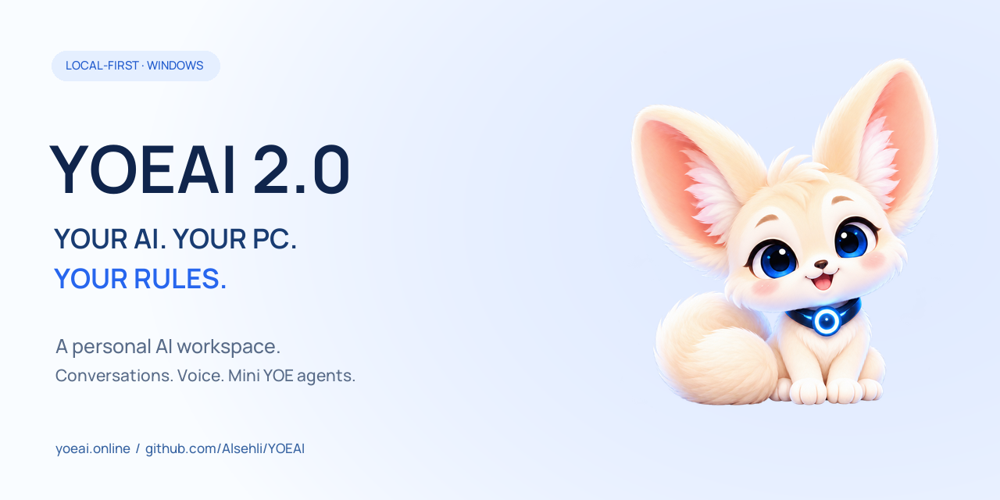

<p align="center"></p>

# YOEAI 2.0

**Your AI. Your PC. Your Rules.** A local-first AI assistant for Windows.

[](https://github.com/Alsehli/YOEAI/blob/release/2.0-20261025-candidate/docs/SETUP.md) [](https://github.com/Alsehli/YOEAI/blob/release/2.0-20261025-candidate/requirements-build.txt) [](https://github.com/Alsehli/YOEAI/blob/release/2.0-20261025-candidate/LICENSE) [](https://github.com/Alsehli/YOEAI/actions/workflows/windows-preview.yml) [](https://github.com/Alsehli/YOEAI/blob/release/2.0-20261025-candidate/docs/RELEASE-CHECKLIST.md)

[Website](https://yoeai.online) · [Setup](https://github.com/Alsehli/YOEAI/blob/release/2.0-20261025-candidate/docs/SETUP.md) · [Release readiness](https://github.com/Alsehli/YOEAI/blob/release/2.0-20261025-candidate/docs/RELEASE-CHECKLIST.md) · [Report a bug](https://github.com/Alsehli/YOEAI/issues/new/choose) · [Contribute](https://github.com/Alsehli/YOEAI/blob/release/2.0-20261025-candidate/CONTRIBUTING.md)

YOEAI combines local language models, practical Windows tools and specialized Mini YOE agents in one desktop workspace. It is a personal, non-profit project created and maintained by **[Mohamed Yusuf Alsehli](https://github.com/Alsehli)**. The cream-white YOE fox is its own visual identity.

> **Source candidate, not a complete installer release.** The [release candidate branch](https://github.com/Alsehli/YOEAI/tree/release/2.0-20261025-candidate) contains Normal 16GB source based on build 2.0.20261025.4 and the verified voice error-display correction. [PR #1](https://github.com/Alsehli/YOEAI/pull/1) remains a draft. Model weights, inference binaries, private profiles and optional runtimes are excluded. Older setup executables must not be treated as builds of this candidate. See [publication gates](https://github.com/Alsehli/YOEAI/blob/release/2.0-20261025-candidate/docs/PUBLICATION.md).

**Default branch notice:** `main` retains the older application snapshot. The feature table and build instructions below describe the separately reviewed release candidate. This homepage update changes documentation only.

## What is included in the candidate?

| Workspace | Implemented capability | Requirements and limits |
|---|---|---|
| Conversation | Shared Fast Qwen3.5 9B / Advanced Qwen3.8 27B selection, history, local memory, Markdown, document/image interactions | Compatible local llama.cpp backend, model and configuration; vision needs a compatible projector |
| Interactive Voice | Local speech recognition and responses, interruption, microphone/speaker controls, transcript | External Python 3.11 Bark Pro and Kokoro/eSpeak runtime; developer paths are not portable setup; Arabic ASR is unavailable in this candidate |
| Windows YOE | File browsing/storage analysis, diagnostics, supported desktop automation | Windows tool adapters, authorized locations and approval for sensitive actions; application-specific support varies |
| Code YOE | Code explanation, debugging, patch proposals and live previews | Uses the selected shared model; running code or applying changes follows tool approvals |
| Research YOE | Local-document analysis, source-linked web research, reports and PDF preparation | Offline analysis uses provided evidence; online search sends queries to the configured provider and needs network access |
| Reverse YOE | Authorized static binary/JavaScript inspection and decompiled-code explanations | Ghidra/JDK and configured adapters for native analysis. The newer LLM4Decompile work is **not included in this candidate** |
| Update YOE | Maintenance proposals, evidence review, staged changes, approval and rollback infrastructure | Execution depends on available isolation; source inspection and tests do not grant permission to deploy changes |
| Game Studio | Conversation-led Unity 2D project workflows and existing project tools | Separately installed/configured Unity; template/contract tests do not certify arbitrary generated games |
| Creative tools | Image Turbo/Design adapters, editable precision typography, video adapter, image-to-PDF and report tools | Image/video workers, models and dependencies are separately configured; not installed by the source build |

Tools operate through their existing permission system. Model output is fallible; generated code, research and pseudocode need review. No claim of unattended operation while the PC is off is made.

## Build and run on Windows

The tested shell build uses **Python 3.13 x64**. Speech uses a separate external Python 3.11 environment. Start in a fresh checkout and install the pinned direct build dependencies:

```powershell
git clone --branch release/2.0-20261025-candidate https://github.com/Alsehli/YOEAI.git
cd YOEAI
py -3.13 -m venv .venv
.\.venv\Scripts\python.exe -m pip install -r requirements-build.txt
.\.venv\Scripts\python.exe tools/check_release.py
.\.venv\Scripts\python.exe tools/test_portable.py
.\.venv\Scripts\python.exe tools/check_docs.py
.\.venv\Scripts\python.exe build.py
```

Output: `dist/YOEAI/YOEAI.exe` and supporting files. Keep the directory intact. This builds the shell; it does not provision models, CUDA or optional runtimes. Follow [setup and portability](https://github.com/Alsehli/YOEAI/blob/release/2.0-20261025-candidate/docs/SETUP.md) to configure your local backend. Test against a disposable profile before using existing history. Do not copy developer process-ownership records or private configuration.

**Hardware:** Windows x64 and a compatible NVIDIA CUDA backend for the documented Normal GPU configuration. Fast and Advanced performance depends on the selected weights, offload/context settings and free VRAM. A 16GB GPU is the development target, not a guarantee that every model and media engine can run together. Lite uses a different framework/package and is not built by this tree.

## Verification, with scope

- Historical qualification: **384 regression tests passed** on 25 October 2026. [Detailed QA](https://github.com/Alsehli/YOEAI/blob/release/2.0-20261025-candidate/docs/QA-20261025.md) identifies mocks, external-runtime limits and untested scenarios.
- The previous source candidate passed GitHub-hosted Windows validation, build and compiled-shell smoke checks: [recorded run](https://github.com/Alsehli/YOEAI/actions/runs/40182136471). The badge above shows the current branch result.
- CI runs a **31-test portable subset** and constructs the compiled UI in a disposable profile without loading models. It does not run a physical microphone or clean-PC installation test.
- [Current release audit](https://github.com/Alsehli/YOEAI/blob/release/2.0-20261025-candidate/docs/RELEASE-AUDIT-20261027.md) and [validation record](https://github.com/Alsehli/YOEAI/blob/release/2.0-20261025-candidate/docs/RELEASE-VALIDATION.md) separate new checks from historical evidence.

No latest-verified-binary badge is shown because this candidate has no newly qualified complete installer release.

## Privacy and security

Local chat uses the configured loopback backend. Web research, external links and optional downloads have network boundaries; local-first does not mean every feature is offline. Microphone use is explicit. Read [Privacy](https://github.com/Alsehli/YOEAI/blob/release/2.0-20261025-candidate/PRIVACY.md) and [Security](https://github.com/Alsehli/YOEAI/blob/release/2.0-20261025-candidate/SECURITY.md) before configuring automation or exposing services.

## Contribute and support

Reproducible bugs, documentation fixes, accessibility feedback and focused patches are welcome. See [Contributing](https://github.com/Alsehli/YOEAI/blob/release/2.0-20261025-candidate/CONTRIBUTING.md), the [conduct policy](https://github.com/Alsehli/YOEAI/blob/release/2.0-20261025-candidate/CODE_OF_CONDUCT.md) and [issue templates](https://github.com/Alsehli/YOEAI/issues/new/choose).

[Optional project support](https://yoeai.online/contribute) does not buy software, access or priority service. YOEAI is a personal non-profit project, not represented as a registered charity.

## License and credits

Application source: **GPL-3.0-only**, [LICENSE](https://github.com/Alsehli/YOEAI/blob/release/2.0-20261025-candidate/LICENSE). Preserve [NOTICE](https://github.com/Alsehli/YOEAI/blob/release/2.0-20261025-candidate/NOTICE) and [third-party notices](https://github.com/Alsehli/YOEAI/blob/release/2.0-20261025-candidate/THIRD-PARTY.md). Optional models, fonts, runtimes and external applications retain their separate terms; source publication is not a blanket redistribution clearance. Builds are unsigned unless explicitly documented otherwise in [Code signing](https://github.com/Alsehli/YOEAI/blob/release/2.0-20261025-candidate/CODE-SIGNING.md).

© 2026 Mohamed Yusuf Alsehli — YOEAI
