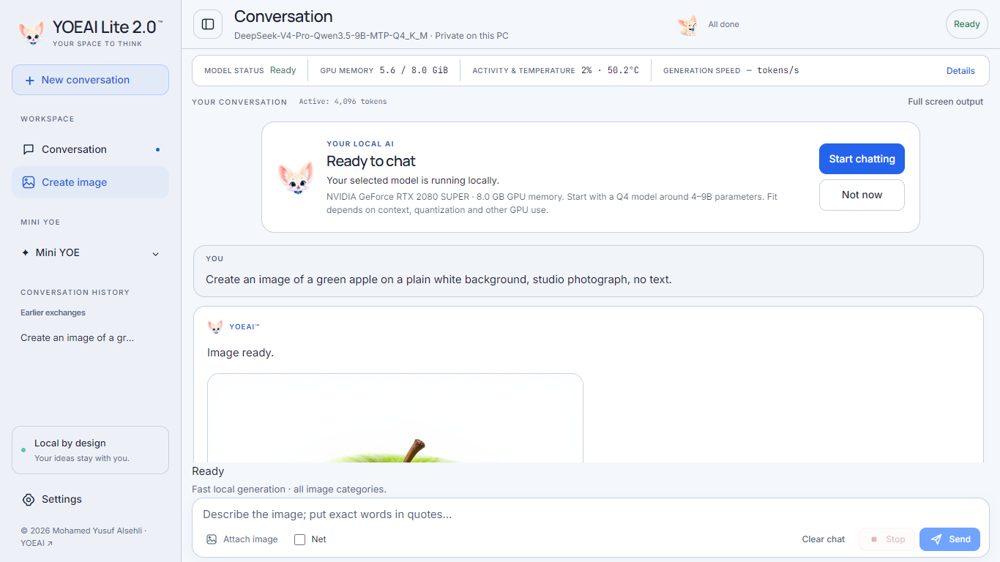

# Lite Image Turbo preview — 8 November 2026

Unsigned Windows x64 prerelease of Lite 8GB, revision **2.0.20261108.1**. This release updates Lite; the Normal installer is unchanged and remains on its previous release page.

## Added

- Create image in the existing Lite sidebar and conversation, powered by local Z-Image Turbo.
- Inline images, Save image, Regenerate, Stop, size settings and an image-model-folder setting.
- CUDA image tools and app-local Microsoft C++ runtime libraries are bundled. Image model weights remain separate and are not downloaded automatically.
- Lite pauses its own chat model while creating an image, then restores it if it was loaded. Chat loads on request. An unloaded chat engine is initialized before generation.

## Install

Download **both** numbered installer parts, `Join-Lite.ps1` and `SHA256SUMS.txt` from this release into one folder. Verify the downloaded files, then run the joiner. It verifies both parts and the reconstructed installer and does not execute the installer automatically. Run `YOEAI-Lite-Setup.exe` when ready. Preserve your profile and existing model files.

The reconstructed installer SHA-256 is `63fe9aeb80973d98f687ead74fb0a6b5a69aec83759bdecd220f145acdc123ff` (3,441,300,249 bytes). GitHub's per-file limit requires splitting this installer for hosting.

For images, keep these existing model files together: `z_image_turbo-Q4_K.gguf`, `Qwen3-4B-Instruct-2507-Q4_K_M.gguf`, and `ae.safetensors`. In Lite Settings, enter their folder under Image generation and choose **Use this folder**. On the maintainer PC the existing image model set was reused. This release does not bundle those weights or a second Python/Torch inference framework for image generation.

## Actual verification

- Tested on an **RTX 2080 SUPER 8GB**, not a 24GB card.
- Real 512×512 generation passed. Separate runs reported 35.7 seconds and 9.8 seconds for the image stage; these are not matched speed benchmarks and exclude subsequent chat-model restoration.
- The compiled Lite app answered a real chat, created an image, restored the chat model, then answered again. Device-wide GPU memory sampled during that test peaked at 5,914 MiB, including desktop use.
- Actual UI Send, inline image display, byte-identical Save download and history after page reload passed without JavaScript errors.
- Invalid requests, foreign origins, path traversal and overlapping image requests were rejected. A separate cancellation completed in about 0.22 seconds in its test.
- Image tool import checks passed with PATH limited to Windows system directories. Required app-local C++ runtime DLLs are included.
- Compiled installer test passed: **6,398 payload files**, profile preservation, executable checksum, native shortcut, image tools and C++ DLL copying. No PowerShell was used by the installer.

## Known limits

A fresh Windows PC and the planned 24GB GPU have **not** been qualified for this revision. 768-pixel generation is selectable but was not exercised in this pass. Lite includes Image Turbo; MOSS Design and the Normal editable Precision Text engine are not part of this Lite feature. Model-drawn lettering is not guaranteed exact. Other GPU workloads can affect performance and available memory. Passing these tests does not certify the whole app or resolve existing dependency alerts.

The experimental search development work is not included or claimed complete here. The stable chat backend remains attributed embedded llama.cpp through its private worker.

## Source and rollback

The matching Lite application and installer source is attached and published under `editions/lite/source`. Native binaries and model weights are excluded from Git history. Keep third-party notices. The prior release remains available for rollback; no old release assets were removed.

## Actual application capture and output

These are maintainer-PC test captures, not a fresh-PC qualification or a 24GB benchmark.
